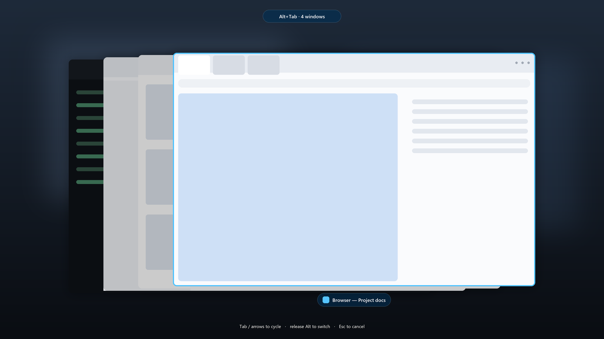

# FlipRow

**English** | [简体中文](README.zh-CN.md)

**A 2D stacked window switcher for Windows.** FlipRow replaces Alt+Tab with a deck of window cards: the active window sits on top, the rest recede to the left, and every Tab press sends the front card to the back of the deck.



> Status: early build. The switcher is usable day to day, live previews and multi-monitor support are still on the roadmap.

---

## Why another Alt+Tab replacement

The stock switcher shows a row of small thumbnails, one per window, and the layout has not changed much since Windows Vista. FlipRow keeps the same one-key workflow but renders the windows as a physical deck of cards: the selected window is large and readable, the others stay visible as edges, and cycling through them looks like turning the deck instead of moving a selection rectangle.

## Features

- **Alt+Tab takeover** through a low-level keyboard hook, with Alt release as confirmation and Esc as cancel.
- **Deck layout**, the selected card is centered and frontmost, the remaining cards stack to the left with a slight offset, scale and dim falloff.
- **Tab rotates the deck**, the front card slides to the tail and fades out, the next card moves forward.
- **Window previews** captured asynchronously on a worker thread, cached per window and refreshed on every open.
- **Minimized windows** are included, badged, and restored on selection.
- **Fluent styling**, 8 px corners, accent-tinted translucent chips, white labels, light and dark themes, per-monitor DPI.
- **Tray menu** in Chinese and English, with language selection and start-with-Windows.
- **Runs as a normal user**, no UAC prompt at start and at logon.
- Single instance, tray icon, hook watchdog and clean shutdown.

## Requirements

- Windows 10 version 1809 or later, or Windows 11, x64.
- No administrator rights required, the executable runs as a normal user.
- Visual Studio 2022 or newer with the Desktop development with C++ workload, only needed to build.

## Build

```bat
build.cmd          :: compile to bin\FlipRow.exe
build.cmd run      :: compile and run
build.cmd demo     :: compile and open the overlay once, no hotkey hook
```

The build script locates vcvars64 through vswhere, compiles every file under `src`, embeds `res\app.rc` and `res\app.manifest`, and writes `bin\FlipRow.exe`.

## Usage

| Input | Action |
|---|---|
| `Alt+Tab` | Open the switcher, then advance one card |
| `Shift+Alt+Tab` | Advance in reverse |
| Release `Alt` | Switch to the selected window |
| `Esc` | Close without switching |
| `Left` `Right` or wheel | Move the selection |
| Click a card | Switch to it immediately |
| Tray left click | Open the switcher |
| Tray right click | Language, hotkey takeover, start with Windows, about, quit |

The first press opens the overlay with the current foreground window in front. Every additional press moves the front card to the tail.

## Configuration

All runtime files live next to the executable and carry the program name.

| File | Purpose |
|---|---|
| `FlipRow.ini` | settings, created on the first change |
| `FlipRow.log` | main log, rewritten on every start |
| `FlipRow.boot.log` | early startup diagnostics, appended |

```ini
[ui]
lang=0    ; 0 follow system, 1 Chinese, 2 English
```

Nothing is written outside the program folder. Running the executable from a read only location therefore disables the log and the settings file, the program still works with its defaults.

## Command line

| Flag | Meaning |
|---|---|
| `--demo` | Open the overlay once and exit after a few seconds |
| `--demo0` | Same as `--demo`, with the current window forced to the front |
| `--demo2` | Open, close, open again, used to verify the second-open behaviour |
| `--no-hook` | Do not install the keyboard hook |
| `--debug` | Verbose logging |
| `--autostart on` `--autostart off` | Create or remove the Run key entry for start with Windows |
| `--version` | Print the version and exit |
| `--quit` | Stop the running instance |

## How it works

1. A thread installs a `WH_KEYBOARD_LL` hook and maintains a small state machine for Alt, Tab and Esc. The hook only posts messages, all work happens on the UI thread.
2. On the first Tab the window list is collected in z-order, filtered with the same rules the shell uses for Alt+Tab, and a full screen DirectComposition overlay is shown.
3. Previews are captured on a worker thread. A hidden window receives the DWM thumbnail of the target, then `PrintWindow` copies the composed image into a BGRA bitmap.
4. Each card position is derived from its depth `d = (i - sel + n) % n`. Depth 0 is the front card, depth `n - 1` is the tail.
5. Cards are drawn with Direct2D on a premultiplied alpha swap chain, animated with an exponential follow that snaps to the target once close enough.

## Known limitations

- A full screen application that is minimized shows only the upper left part of its content, because the restored window rect is smaller than the full screen size.
- Visibility is evaluated against the primary monitor only, multi-monitor layouts are not handled yet.
- Previews are snapshots, video and animation are not visible in the cards.
- Windows owned by an elevated process are listed but show an icon placeholder, and the keyboard hook does not see input while such a window has focus.
- The background is a blurred snapshot of the desktop, it does not update while the overlay is open.
- Rounded corner geometry is rebuilt every frame.
- Hiding and terminating applications from the switcher is not implemented.
- A full screen exclusive application can cover the overlay.

## Project layout

```
src/
  main.cpp        hook, single instance, tray, message dispatch
  stack.cpp       overlay, deck layout, animation, painting, hit testing
  preview.cpp     window snapshots through DWM thumbnail and PrintWindow
  wins.cpp        window enumeration, grouping, icons, activation, virtual desktops
  gfx.cpp         Direct2D and DirectComposition wrapper, Fluent palette, frame clock
  anim.cpp        easing curves and spring
  tray.cpp        tray icon and menu
  startup.cpp     start with Windows through the Run key
  common.cpp      logging, language, injected key marker
res/
  app.ico         application icon
  app.manifest    asInvoker, per monitor DPI
  tray/           monochrome tray icons, black and white variants
docs/
  screenshot.png  rendering mockup
```

## License

Copyright (c) 2026 RiBunsyou <Ri_Bunsyou@outlook.com>

GNU General Public License v3.0, see [LICENSE](LICENSE).

FlipRow is free software, you can redistribute it and or modify it under the terms of the GNU General Public License as published by the Free Software Foundation, version 3 of the License.

FlipRow is distributed in the hope that it will be useful, but without any warranty, without even the implied warranty of merchantability or fitness for a particular purpose. See the GNU General Public License for more details.
