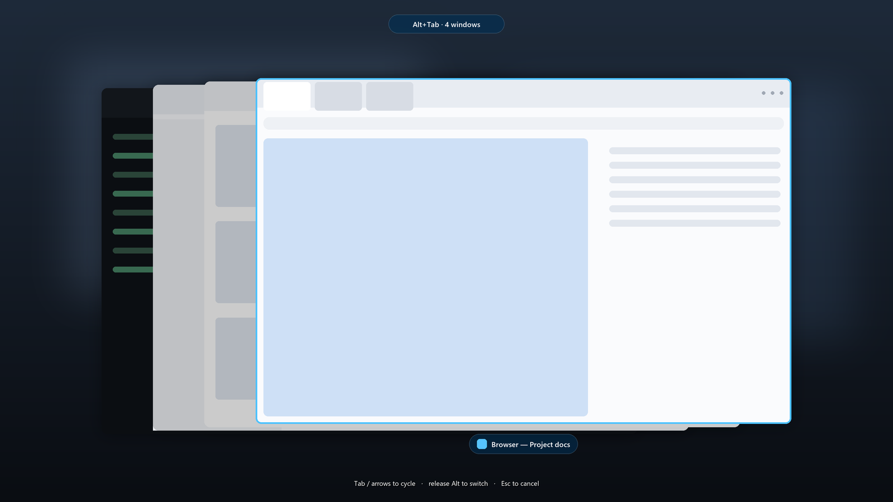

# FlipRow

**简体中文** | [English](README.md)

**Windows 上的二维堆叠式窗口切换器。** FlipRow 用一叠窗口卡片取代 Alt+Tab：当前窗口在最上面，其余窗口向左后方退开，每按一次 Tab 就把最前面的卡片送到队尾。



> 状态：早期版本。日常使用已经可用，实时预览和多显示器支持仍在计划中。

---

## 为什么再做一次 Alt+Tab

系统自带的切换器把窗口排成一行小缩略图，布局从 Windows Vista 起几乎没有变化。FlipRow 保留一键切换的操作方式，但把窗口画成一副可以翻阅的牌：选中的窗口足够大，内容看得清，其余窗口以边缘的形式保留位置感，轮换时像在翻牌，而不是在移动一个选择框。

## 功能

- **接管 Alt+Tab**，通过底层键盘钩子实现，松开 Alt 提交，Esc 取消。
- **牌堆布局**，选中的卡片居中且在最前，其余卡片向左堆叠，逐层缩小并压暗。
- **Tab 轮换牌堆**，最前面的卡片滑向队尾并淡出，下一张补上来。
- **窗口预览**，在工作线程异步抓取，按窗口缓存，每次打开都刷新。
- **最小化窗口**一并纳入，卡片上带标记，选中后自动还原。
- **Fluent 外观**，8 像素圆角，强调色半透明胶囊，白色文字，跟随系统深浅色，支持每显示器 DPI。
- **托盘菜单**，中英文可切换，包含语言选择和开机自启。
- **以管理员身份运行**，管理员窗口在前台时钩子同样生效。
- 单实例运行，托盘图标，钩子看门狗，退出时干净收尾。

## 系统要求

- Windows 10 1809 或更高版本，或 Windows 11，64 位。
- 管理员权限，程序通过清单申请提权。
- Visual Studio 2022 或更新版本，需安装使用 C++ 的桌面开发工作负载，仅编译时需要。

## 编译

```bat
build.cmd          :: 编译到 bin\FlipRow.exe
build.cmd run      :: 编译并运行
build.cmd demo     :: 编译并打开一次浮层，不接管热键
```

编译脚本通过 vswhere 定位 vcvars64，编译 `src` 下的全部源文件，链接 `res\app.rc` 和 `res\app.manifest`，输出 `bin\FlipRow.exe`。

## 使用

| 操作 | 作用 |
|---|---|
| `Alt+Tab` | 打开切换器，再按一次向前翻一张 |
| `Shift+Alt+Tab` | 反向翻一张 |
| 松开 `Alt` | 切换到选中的窗口 |
| `Esc` | 关闭界面，不切换 |
| `←` `→` 或滚轮 | 移动选择 |
| 单击卡片 | 立即切换到该窗口 |
| 托盘左键 | 打开切换器 |
| 托盘右键 | 语言，接管 Alt+Tab，开机自启，退出 |

第一次按下时打开浮层，正面是当前的前台窗口。之后每按一次，最前面的卡片就会送到队尾。

## 配置文件

所有运行时文件都在程序所在目录，文件名带程序名。

| 文件 | 作用 |
|---|---|
| `FlipRow.ini` | 设置项，首次修改时创建 |
| `FlipRow.log` | 主日志，每次启动重写 |
| `FlipRow.boot.log` | 启动早期诊断，追加写入 |

```ini
[ui]
lang=0    ; 0 跟随系统，1 中文，2 英文
```

程序不向自身目录之外写入任何文件。放在只读目录时日志和设置文件不可用，程序仍以默认值运行。

## 命令行

| 参数 | 含义 |
|---|---|
| `--demo` | 打开一次浮层，几秒后退出 |
| `--demo0` | 同 `--demo`，强制把当前窗口放在正面 |
| `--demo2` | 打开，关闭，再打开，用于验证第二次打开的表现 |
| `--no-hook` | 不安装键盘钩子 |
| `--debug` | 输出详细日志 |
| `--autostart on` `--autostart off` | 创建或删除启动文件夹中的快捷方式 |
| `--version` | 输出版本号后退出 |
| `--quit` | 退出正在运行的实例 |

## 实现原理

1. 一个线程安装 `WH_KEYBOARD_LL` 钩子，维护 Alt，Tab 和 Esc 的状态机。钩子只负责投递消息，实际处理都在界面线程完成。
2. 第一次按下 Tab 时按 z 序收集窗口，用与系统 Alt+Tab 相同的规则过滤，然后显示全屏的 DirectComposition 浮层。
3. 预览在工作线程中抓取。先让一个隐藏窗口接收目标窗口的 DWM 缩略图，再用 `PrintWindow` 把合成后的画面复制成 BGRA 位图。
4. 每张卡片的位置由层深 `d = (i - sel + n) % n` 决定。层深 0 是正面，层深 `n - 1` 是队尾。
5. 卡片由 Direct2D 绘制在预乘 alpha 的交换链上，动画使用指数逼近，接近目标后直接吸附。

## 已知限制

- 全屏应用最小化后，预览只显示内容的左上部分，原因是还原矩形小于全屏尺寸。
- 只按主显示器判定窗口可见性，多显示器场景尚未处理。
- 预览为静态快照，视频和动画在卡片里看不出来。
- 由其他提权进程拥有的窗口无法抓取，这类窗口在前台时钩子也收不到输入。
- 背景是桌面快照的模糊结果，浮层打开期间不会更新。
- 圆角几何每帧重建。
- 从切换器里隐藏或结束应用尚未实现。
- 独占全屏应用可能覆盖浮层。

## 项目结构

```
src/
  main.cpp        钩子，单实例，托盘，消息分发
  stack.cpp       浮层，牌堆布局，动画，绘制，命中测试
  preview.cpp     通过 DWM 缩略图和 PrintWindow 抓取窗口
  wins.cpp        窗口枚举，分组，图标，激活，虚拟桌面
  gfx.cpp         Direct2D 与 DirectComposition 封装，Fluent 配色，帧时钟
  anim.cpp        缓动曲线与弹簧
  tray.cpp        托盘图标与菜单
  startup.cpp     通过启动文件夹快捷方式实现开机自启
  common.cpp      日志，语言，注入按键标记
res/
  app.ico         应用图标
  app.manifest    requireAdministrator，每显示器 DPI
  tray/           单色托盘图标，黑白两套
docs/
  screenshot.png  示意图
```

## 许可证

Copyright (c) 2026 RiBunsyou <Ri_Bunsyou@outlook.com>

GNU 通用公共许可证第 3 版，见 [LICENSE](LICENSE)。

FlipRow 是自由软件，你可以依据自由软件基金会发布的 GNU 通用公共许可证第 3 版的条款重新发布或修改它。

FlipRow 的发布是希望它有用，但不提供任何担保，也不提供适销性或特定用途适用性的默示担保。更多细节见 GNU 通用公共许可证。
